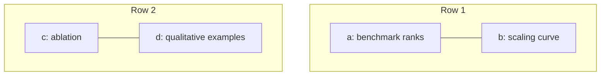

# PANEL_MAP

One status table for every panel of every figure. No nested per-figure maps. Update it in
the same edit as any panel, data or status change. Displayed letters may differ from file
stems; the Panel column holds the displayed letter.

Status: `draft` or `final`. Synced: `-` until a doc-sync sweep has folded the panel's lessons
into the guideline files, then `yes`.

## Figure [N]: [the figure's one-sentence claim]



| Panel | Name | Claim role | Aesthetic anchor | Upstream source | Script | Output | Status | Synced | Notes |
|---|---|---|---|---|---|---|---|---|---|
| [N].a | [benchmark ranks] | [establish: the method ranks first on most tasks] | [reference figure and panel it copies] | [upstream script or "new"] | `code/figure_[N]/panel_a_[name].py` | `figures/figure_[N]/panels/panel_a_[name].{pdf,png}` | draft | - | [run ids, filters, n, what is deliberately not plotted] |

### Figure [N] composition

Canvas [183] x [H] mm. Geometry lives in `code/figure_[N]/_prep/figure_[N]_geometry.json`;
the composer and every panel read it.

- Row 1 (top [y] mm, height [h] mm): a at x = [0], w = [w]; b at x = [x], w = [w].
- Row gap [1.5] mm; letter band [4.5] mm; letters [8] pt bold.

Generation, in order:

```bash
python code/figure_[N]/_prep/[build_table].py     # raw outputs -> data/figure_[N]/[table].tsv
python code/figure_[N]/panel_a_[name].py
python code/figure_[N]/_compose_figure_[N].py      # -> figures/figure_[N]/figure_[N].{pdf,png}
```

QA notes: [what to look at after a re-render, e.g. "the default line in Supp 3 sits at the main-figure value"].

Retired, do not re-add: [chart form or panel, with the reason it was dropped].
